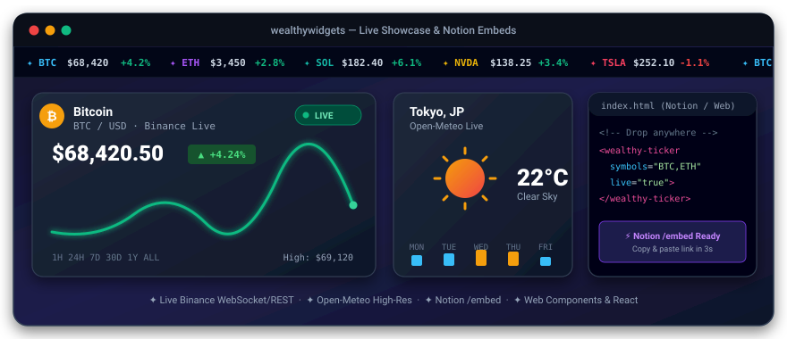

<div align="center">


# 🧩 wealthywidgets

**A production-ready UI & live financial widget library with AI generation, real-time live data, and zero-build embeds.**

[](https://github.com/anom-developer/wealthywidgets/actions/workflows/ci.yml)
[](https://anom-developer.github.io/wealthywidgets/)
[](https://anom-developer.github.io/wealthywidgets/embed.html)
[](https://anom-developer.github.io/wealthywidgets/)
[](https://www.typescriptlang.org/)
[](LICENSE)

<br/>

<a href="https://anom-developer.github.io/wealthywidgets/">
  
</a>

</div>

---

## ✨ Available Widgets & Components

| Component | Description | Live API / AI | Web Component |
| --- | --- | :---: | :---: |
| **`Ticker`** | Continuous marquee ticker bar with live crypto/stock quotes & hover-pause | ✦ Binance Live | `<wealthy-ticker>` |
| **`FinanceWidget`** | Real-time crypto & stock portfolio tracker with interactive SVG sparklines | ✦ Binance Live | `<wealthy-finance>` |
| **`WeatherWidget`** | Real-time weather card with geocoding, WMO icons, and 7-day forecast | ✦ Open-Meteo | `<wealthy-weather>` |
| **`ActivityWidget`**| Scrollable timeline with relative timestamps and AI activity feed generator | ✦ AI Gen | `<wealthy-activity>` |
| **`CodeWidget`** | macOS-style code block with line highlighting, copy button, and editable mode | ✦ AI Gen | `<wealthy-code>` |
| **`Button`** | Buttons with variants (`primary`, `secondary`, `outline`, `ghost`, `danger`, `success`), sizes, and loading spinners | — | React UI |
| **`Card`** | Content container with image cover, header, body, and actions | — | React UI |
| **`Input`** | Text field with validation states, prefix/suffix icons, and inline AI generation | ✦ AI Gen | React UI |
| **`Modal`** | Accessible dialog with backdrop, escape key handling, and focus traps | — | React UI |
| **`Dropdown`** | Searchable single and multi-select dropdown with tag chips | — | React UI |
| **`ProgressBar`** | Colored progress indicator with striped and animated modes | — | React UI |
| **`Tooltip`** | Lightweight hover hint with directional placement | — | React UI |
| **`Badge`** | Notification and category pill with dot indicator | — | React UI |
| **`Toast`** | App-wide toast notification system via `ToastProvider` & `useToast()` | — | React UI |

> 📖 **[Open Live Showcase & Embed Studio →](https://anom-developer.github.io/wealthywidgets/)**

---

## 🚀 3 Ways to Use WealthyWidgets

### 1. 📌 Notion Embed (/embed)

Embed interactive live widgets directly into your **Notion** workspaces and dashboards:

1. In Notion, type `/embed` on any page and press Enter.
2. Paste the link for your desired widget:
   - **Live Crypto Tracker**: `https://anom-developer.github.io/wealthywidgets/embed.html?widget=finance&asset=BTC&curr=USD&notion=true`
   - **Market Ticker Bar**: `https://anom-developer.github.io/wealthywidgets/embed.html?widget=ticker&symbols=BTC,ETH,SOL,BNB,DOGE&curr=USD&notion=true`
   - **Live Weather Forecast**: `https://anom-developer.github.io/wealthywidgets/embed.html?widget=weather&city=Tokyo&unit=C&notion=true`
   - **Project Activity Feed**: `https://anom-developer.github.io/wealthywidgets/embed.html?widget=activity&title=Project%20Updates&notion=true`
3. Click **Embed link** and resize the block freely!
   - Blends into Notion's dark and light backgrounds seamlessly.
   - Automatically adapts when you resize columns or view on the Notion Mobile app.

---

### 2. Pure HTML & Web Components (Zero Setup)

Works out of the box in pure HTML, WordPress, Webflow, Shopify, or any static site without npm or build tools:

```html
<!-- 1. Include stylesheet & bundle -->
<link rel="stylesheet" href="https://anom-developer.github.io/wealthywidgets/dist/styles.css" />
<script src="https://anom-developer.github.io/wealthywidgets/dist/wealthywidgets.js"></script>

<!-- 2. Drop widgets anywhere in your body -->
<wealthy-ticker symbols="BTC,ETH,SOL,BNB,DOGE,NVDA,AAPL,TSLA" currency="USD" speed="25"></wealthy-ticker>
<wealthy-finance asset="BTC" currency="USD" live="true"></wealthy-finance>
<wealthy-weather city="Tokyo" temp="22" unit="C" live="true"></wealthy-weather>
<wealthy-activity title="Recent Activity"></wealthy-activity>
<wealthy-code title="app.ts">console.log("Hello from WealthyWidgets!");</wealthy-code>
```

> 💡 **Visual Configurator**: Open [`docs/index.html`](https://anom-developer.github.io/wealthywidgets/) → **Embed Studio 🚀** to visually configure any widget, preview it live, copy embed codes, or download standalone `.html` files.

---

### 3. React & TypeScript Component Library

Install in your project:

```bash
pnpm add wealthywidgets
# or
yarn add wealthywidgets
```

Use components anywhere in your React tree:

```tsx
import { Ticker, FinanceWidget, WeatherWidget, Button } from 'wealthywidgets';
import 'wealthywidgets/dist/styles.css';

export default function App() {
  return (
    <div>
      {/* Real-time Ticker Bar across the header */}
      <Ticker speed={25} currency="USD" live={true} />

      <div style={{ display: 'flex', gap: '24px', flexWrap: 'wrap', padding: '24px' }}>
        <FinanceWidget title="Crypto Portfolio" currency="USD" />
        <WeatherWidget location="San Francisco, CA" temperature={23} />
      </div>
    </div>
  );
}
```

---

## ⚡ Live Real-World APIs & Offline Fallback

WealthyWidgets connects to public, zero-key REST APIs for real-time live data:
- **Cryptocurrency Live Quotes**: Binance Public 24hr Ticker API (`https://api.binance.com/api/v3/ticker/24hr?symbol=...`). Streams real-time prices, 24h highs/lows, and percentage changes.
- **Global Weather Forecasts**: Open-Meteo Geocoding & High-Resolution Forecast (`https://geocoding-api.open-meteo.com` & `https://api.open-meteo.com`). Fetches actual temperatures, WMO weather codes, wind speeds, and relative humidity for any city worldwide.
- **Multi-Currency Support**: Native currency formatting for `USD ($)`, `EUR (€)`, `GBP (£)`, `JPY (¥)`, and `RUB (₽)`.
- **Graceful Offline Fallback**: If network is unavailable or rate-limited, all widgets instantly render built-in realistic mock data with zero disruption.

---

## 📱 Progressive Web App (PWA)

WealthyWidgets documentation and showcase is a certified Progressive Web App:
- Open `docs/index.html` in Chrome, Safari, or Edge.
- Click **"Install PWA App"** (or Safari Share → *Add to Home Screen*).
- Launches in a standalone full-screen window with custom violet theme and app icon.
- Full offline support powered by `docs/sw.js` (Service Worker cache).

---

## 🎨 Customisation & SCSS

Override variables before importing the library:

```scss
$color-primary: #7c3aed;
$color-primary-hover: #6d28d9;
$font-family-base: -apple-system, BlinkMacSystemFont, 'Segoe UI', Roboto, sans-serif;
$radius-md: 0.5rem;

@use 'wealthywidgets/src/styles/variables' as *;
```

---

## 🛠 Development & Testing

```bash
# Install dependencies
pnpm install

# Run type check
pnpm run type-check

# Run unit tests
pnpm test

# Build production library
pnpm run build
```

---

## 📄 License

MIT © [anom-developer](https://github.com/anom-developer)
